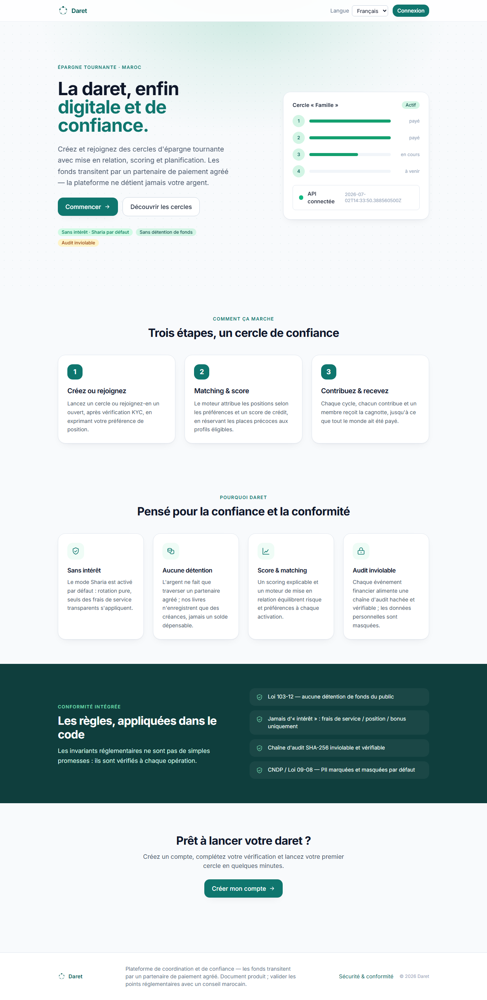
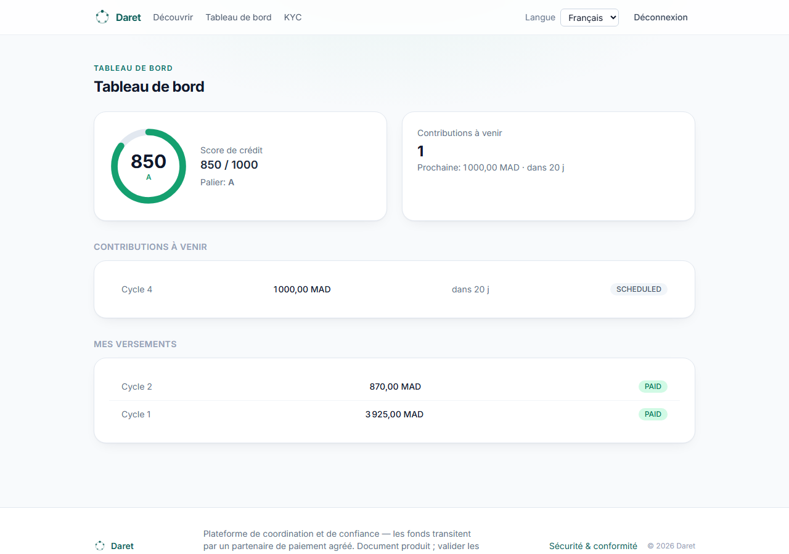
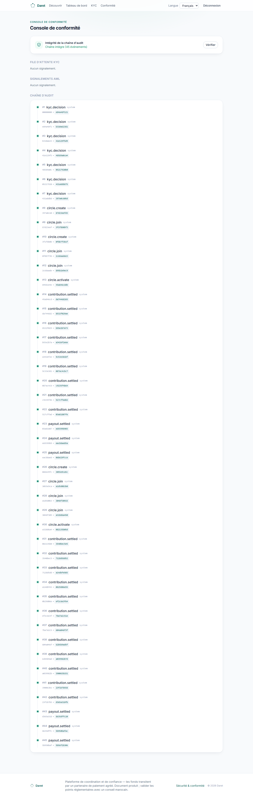
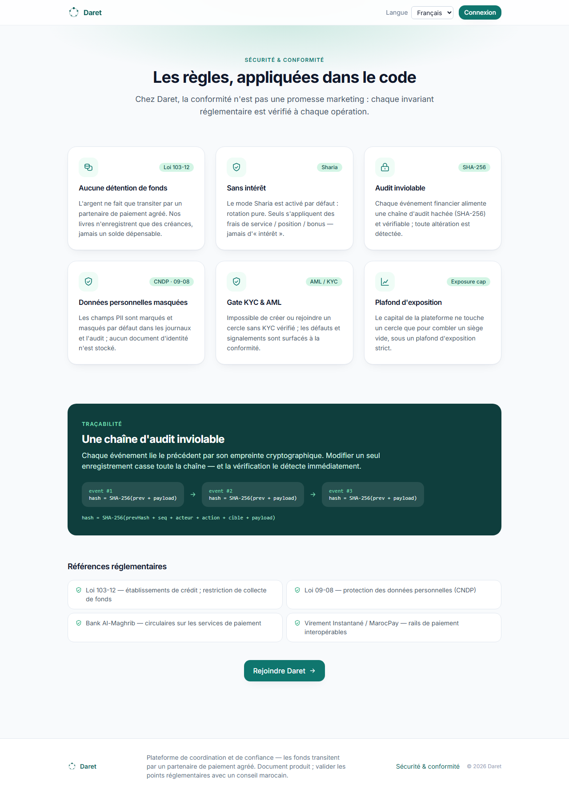

<div align="center">

# 🔄 Daret — Frontend

### L'épargne tournante marocaine, digitale et de confiance

PWA Next.js (App Router) pour la *daret* (ROSCA) : onboarding, découverte de cercles,
aperçu des frais, tableau de bord et console de conformité — en **fr / ar / darija**
avec RTL soigné.


&nbsp;
&nbsp;
&nbsp;
&nbsp;



</div>

> API & orchestration : **[hassanlahlami/daret-backend](https://github.com/hassanlahlami/daret-backend)**
> (Spring Boot, grand livre en partie double, scoring, conformité). Ce dépôt est l'app web.

## ✨ Points forts

| | |
|---|---|
| ☪️ **Sans intérêt / Sharia par défaut** | Slider d'aperçu des frais : chaque position montre coût/gain **avant** de s'engager. |
| 🎯 **Scoring visible** | Jauge de score (A–E), badges de standing, compte à rebours d'échéance. |
| 🛡️ **Conformité** | Timeline d'audit inviolable, file KYC, flags AML — console dédiée (role-gated). |
| 🌍 **fr / ar / darija** | i18n `next-intl`, RTL arabe via propriétés logiques Tailwind. |
| 🔐 **Session** | JWT + refresh rotatif, garde de route par rôle, client API typé. |

## 📸 Aperçu

| Tableau de bord | Console conformité | Sécurité & conformité |
|---|---|---|
| [](./docs/img/dashboard.png) | [](./docs/img/compliance.png) | [](./docs/img/securite.png) |

## 🚀 Démarrer

**Full stack en une commande** (recommandé) — via le dépôt backend qui porte le
`docker-compose` : voir [daret-backend](https://github.com/hassanlahlami/daret-backend).

**Front seul** (nécessite Node ≥ 20 et l'API sur `:8080`) :

```bash
npm install
npm run dev            # http://localhost:3000
```

`NEXT_PUBLIC_API_BASE_URL` pointe l'API (défaut `http://localhost:8080`).
Suivez le [**scénario de démo guidé →**](./docs/DEMO.md).

## 🏗️ Architecture (front)

- **App Router** + Server Components (landing/sécurité statiques) + Client Components (flux authentifiés).
- **Session** : `SessionProvider` (JWT décodé), `RequireAuth` (garde par rôle), `api-client` (bearer + refresh sur 401).
- **State** : TanStack Query (serveur), i18n `next-intl` (`[locale]` routing, RTL).
- **Design system** : Tailwind (brand teal + accent ambre), composants `ui/`, `ScoreGauge`, `Stepper`, `AuditTimeline`.

## ✅ Qualité

```bash
npm run build                              # typecheck + build (toutes les routes, 3 locales)
E2E_API=http://localhost:8080 npm run e2e  # Playwright (backend seedé requis)
```

La suite E2E couvre l'auth + garde, l'assistant de création, le tableau de bord, la
console conformité + intégrité, et les **flux monétaires** (contribuer→verser,
impayé→défaut) — **8/8**.

## 📄 Pages

Auth (login/register) · KYC (stepper + consentement CNDP) · Découverte · Assistant de
création · Détail de cercle (slider de frais + adhésion) · Tableau de bord · Console
conformité (role-gated) · Sécurité & conformité (publique) · États erreur/chargement/404.

---

*Plateforme de coordination et de confiance — les fonds transitent par un partenaire de
paiement agréé. Valider les points réglementaires avec un conseil marocain.*
