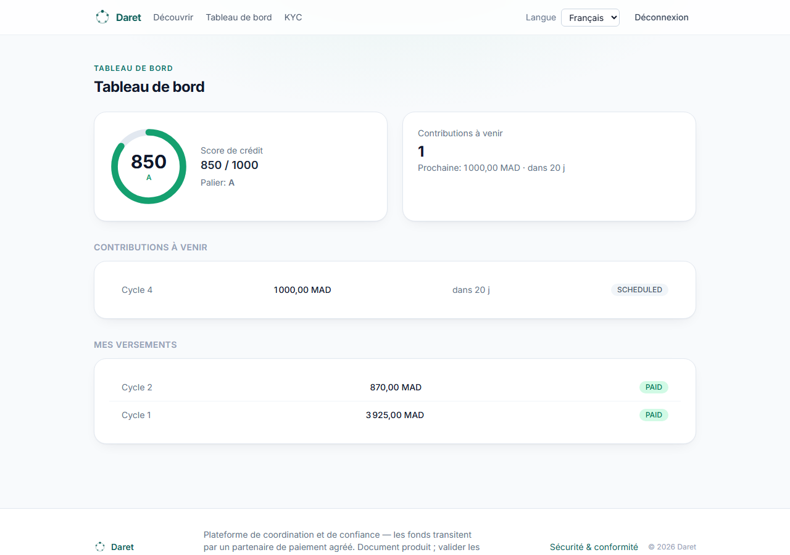
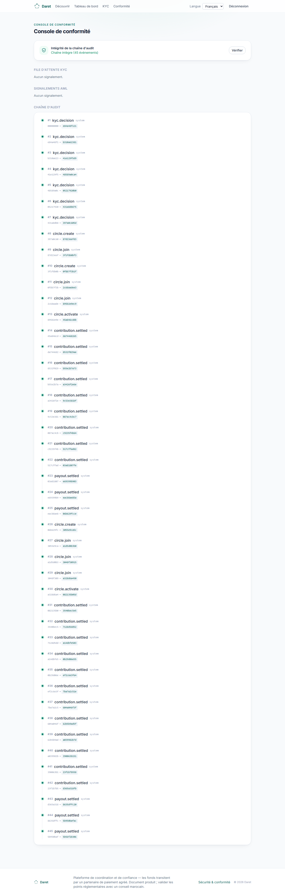
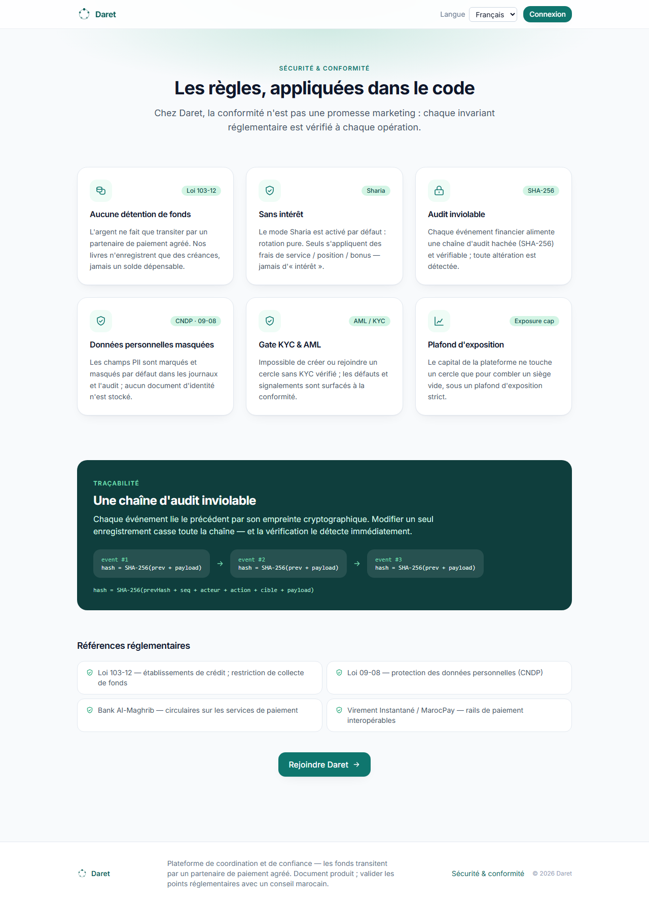

# 🎬 Scénario de démo guidé

Un parcours de ~10 minutes qui montre les capacités clés de Daret : onboarding,
économie des cercles, flux monétaire, risque/scoring et conformité.

## 0. Lancer avec des données de démo

```bash
cp .env.example .env
# Backend seedé + frontend
DARET_SEED_ENABLED=true docker compose up --build
```

Le seeder crée (mot de passe `password123` partout) :

| Compte | Rôle |
|---|---|
| `demo1@daret.demo` … `demo5@daret.demo` | Membres vérifiés |
| `admin@daret.demo` | ADMIN (déclencheurs d'exploitation) |
| `compliance@daret.demo` | COMPLIANCE_OFFICER (console conformité) |

…et **3 cercles** : un `FORMING` (ouvert), un `ACTIVE` à mi-vie (3/4 cycles réglés)
et un `COMPLETED`.

---

## 1. Le tableau de bord d'un membre

Connectez-vous avec **`demo1@daret.demo`**. Sur **Tableau de bord** :

- **Jauge de score** (A–E) calculée à partir de l'historique de paiement, du KYC et de l'ancienneté ;
- **Contributions à venir** avec compte à rebours d'échéance ;
- **Mes versements** avec statut `PAID` / `SCHEDULED`.



## 2. Découverte, aperçu des frais & adhésion

**Découvrir** → ouvrez le cercle `FORMING`. Faites glisser le **slider de position** :
chaque position affiche, *avant de vous engager*, la date de versement projetée, les
frais de service / position, le bonus et l'**ajustement net** — les positions précoces
paient (emprunt), les tardives gagnent (épargne). Choisissez une préférence puis
**Rejoindre**.

> Essayez aussi **Créer un cercle** : nom, montant, sièges, cadence, mode Sharia.

## 3. Flux monétaire (contribuer → verser)

En tant qu'**admin**, déclenchez le pipeline (le planificateur le fait aussi
automatiquement). Exemple via l'API :

```bash
# jeton admin
TOKEN=$(curl -s localhost:8080/api/v1/auth/login -H 'Content-Type: application/json' \
  -d '{"email":"admin@daret.demo","password":"password123"}' | jq -r .accessToken)

# collecter → régler → verser jusqu'à une date donnée
curl -s -X POST "localhost:8080/api/v1/admin/ops/run-cycle?asOf=2030-01-01" \
  -H "Authorization: Bearer $TOKEN"
```

Le grand livre en partie double reste **équilibré à 0.00** globalement, et un membre ne
peut jamais être payé deux fois (invariant DB + ledger).

## 4. Risque : impayés → défaut

```bash
curl -s -X POST "localhost:8080/api/v1/admin/ops/run-default-sweep?asOf=2030-01-01" \
  -H "Authorization: Bearer $TOKEN"
```

Les contributions en retard passent `MISSED`, les membres `LATE` puis `DEFAULTED`
après la fenêtre de grâce — et remontent en **flags AML** côté conformité.

## 5. La console de conformité

Déconnectez-vous, reconnectez-vous avec **`compliance@daret.demo`** → **Conformité** :

- **Vérifier** l'intégrité de la chaîne d'audit → *« Chaîne intègre »* ;
- **File KYC** : approuvez / rejetez des profils en attente ;
- **Flags AML** : membres en défaut ;
- **Timeline d'audit** : chaque événement lié au précédent par son empreinte.



> Preuve d'inviolabilité : modifiez une ligne d'`audit_events` en base, revenez cliquer
> **Vérifier** → la rupture est détectée avec le n° de séquence.

## 6. Multilingue & RTL

Changez la langue en **العربية** (en-tête) : toute l'interface bascule en **RTL**.
La page publique **Sécurité & conformité** (pied de page) présente les invariants
réglementaires.



---

*Astuce : `mvn verify` (Backend) lance les tests d'intégration Testcontainers, et
`npm run e2e` (frontend, backend seedé requis) rejoue les parcours bout-en-bout.*
